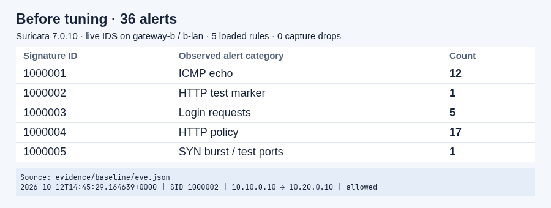
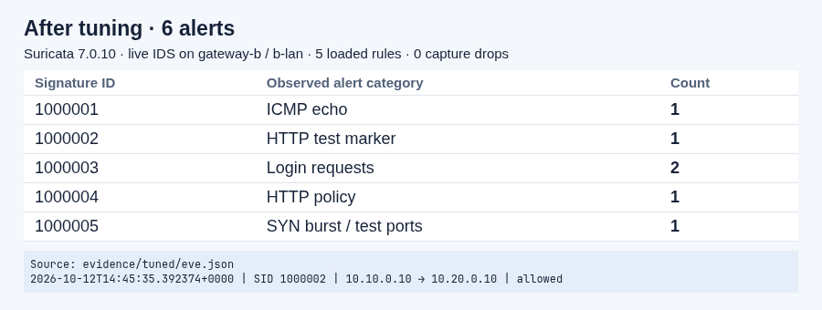

# Site-to-site VPN with a tuned IDS and inline IPS

Two office networks joined by a WireGuard tunnel, with Suricata inspecting the traffic between them: first as an IDS with noisy rules, then tuned, then inline as an IPS that blocks. Everything runs in unprivileged Linux network namespaces, so there are no virtual machines, no root and nothing left running afterwards.

```
 site-a host            gateway-a                    gateway-b              site-b host
 10.10.0.0/24  ──────  WireGuard  ═══ 192.0.2.0/30 ═══  WireGuard  ──────  10.20.0.0/24
                        10.255.0.1   (UDP 51820, WAN)   10.255.0.2          HTTP server :8080
                                                        Suricata on the LAN side
```

## Results

The same scripted traffic was sent in each run: 12 pings, 10 health checks, 5 login requests, 1 admin request, 1 harmless attack marker and connection attempts to 20 closed ports.

| Rule (SID) | Before tuning | After tuning | What changed |
|---|---|---|---|
| ICMP echo (1000001) | 12 | 1 | Limited to one alert per source per minute |
| Attack marker (1000002) | 1 | 1 | Unchanged: this is the one that must always fire |
| Login requests (1000003) | 5 | 2 | Alerts only after three requests per source per minute |
| HTTP policy (1000004) | 17 | 1 | Narrowed from every GET to the `/admin` path |
| SYN burst (1000005) | 1 | 1 | Unchanged |
| **Total** | **36** | **6** | 83% fewer alerts, no detection lost |

| Check | Result |
|---|---|
| Both sites reach each other through the tunnel | Pass |
| With the tunnel down, no traffic crosses (no bypass route) | Pass |
| WAN capture shows only encrypted UDP, no HTTP content | Pass |
| Replaying the baseline capture through the tuned rules gives the same 6 alerts | Pass |
| Inline IPS drops the attack marker; it never reaches the server | Pass |
| Normal requests still succeed before and after the block | Pass |
| Packets dropped by the sensor during capture | 0 |

The one-page write-up is [report/lab-report.pdf](report/lab-report.pdf). Every command that was run is in [evidence/commands.log](evidence/commands.log), and the raw Suricata output and packet captures are beside it.




## Why the tuning matters

An IDS that fires 36 times for a handful of events worth looking at trains the analyst to ignore it. The tuning here follows one rule: cut noise without touching the signatures that matter. The replay test is the proof. The original capture is fed through the tuned rules offline, so the before and after numbers are compared on identical packets and not on two slightly different runs.

## Control mapping (NCA ECC-2:2024)

| Control | How the lab demonstrates it |
|---|---|
| 2-5-3-1 Network segmentation using firewalls and defence in depth | Gateways forward only between the two site subnets; everything else is dropped |
| 2-5-3-6 Intrusion Prevention Systems | Suricata inline on NFQUEUE drops the marker request |
| 2-8-3-3 Encryption of data in transit | WAN capture contains only WireGuard-encrypted UDP |
| 2-12-3-1 Activation of cybersecurity event logs | Suricata EVE JSON logs kept for every run |
| 2-12-3-4 Continuous monitoring of event logs | Alert tuning keeps monitoring usable |

## Reproduce

Needs Linux with unprivileged user and network namespaces, WireGuard and NFQUEUE support in the kernel, plus bash, curl, tar, unshare and Python 3.

```bash
bash scripts/bootstrap.sh     # downloads Alpine 3.22 (checksum verified) and installs the tools into runtime/
bash scripts/run-lab.sh > evidence/run-console.log 2>&1
python3 scripts/build-report.py   # optional, needs Chromium
```

A run takes about two minutes and replaces the files in `evidence/`. Private keys are generated in a tmpfs and discarded when the run ends; the example configs hold placeholders. Tool versions used for the recorded run are in [evidence/versions.txt](evidence/versions.txt) (Suricata 7.0.10).

## Limits

- The five rules are small lab signatures. The "attack" is a harmless URL marker, and the login rule counts requests, not failed logins.
- The SYN rule counts connection attempts in a port range. It does not count distinct ports, so it is not a real port-scan detector.
- The 83% reduction describes this traffic mix. It is not a false-positive rate for a production network.
- Suricata sees the traffic after decryption on the LAN side. Placed on the WAN side it would see nothing useful, which is the point of the WAN capture check.
