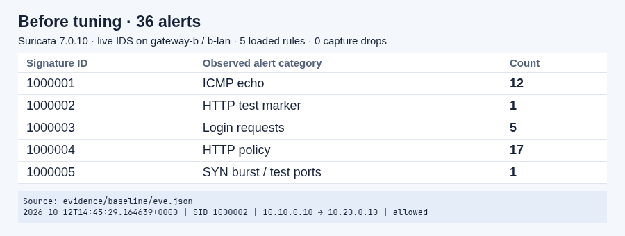
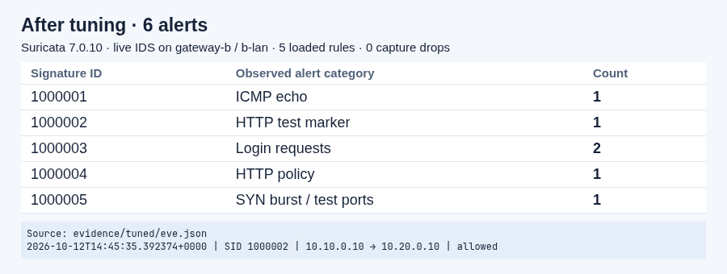

# Site-to-Site VPN and IDS/IPS Lab

**Date:** 2026-10-12 · **Environment:** isolated Linux network namespaces.

**Configuration.** WireGuard linked Site A `10.10.0.0/24` and Site B `10.20.0.0/24` over WAN `192.0.2.1–192.0.2.2`, using UDP 51820, tunnel `10.255.0.0/30`, MTU 1420, peer keys and subnet routes. Gateways enabled IPv4 forwarding and allowed only intersite forwarding. Suricata 7.0.10 inspected decrypted traffic on Site B's LAN with five local rules; both LANs were included in `HOME_NET`.

**Traffic.** Each IDS run sent 12 pings, 10 `/health`, five `/login`, one `/admin`, one harmless `/lab-attack` HTTP request, and connection attempts to 20 closed TCP ports (20000–20019).

**Alerts and tuning.** Alerts fell from **36 to 6 (83.3% fewer)**. ICMP was limited to one alert/source/60 seconds; login alerts began after three requests/source/60 seconds; the broad GET rule was narrowed to `/admin`. The attack-marker and SYN-burst rules stayed active. The SYN rule detects a rate within the test port range, not unique ports; login requests do not prove failed authentication.

**Verification.** Both sites communicated; disabling the tunnel stopped intersite traffic. WAN captures contained encrypted UDP and no HTTP markers. Replaying the same baseline capture with tuned rules reproduced the tuned counts. All rules loaded; live IDS recorded zero capture drops and invalid TCP checksums. Inline NFQUEUE IPS logged the marker as `blocked`; its request timed out and never reached the server, while benign requests returned HTTP 200 before and after.

*Screenshots show a browser viewer of actual saved EVE logs. Configs, commands, logs and packet captures are included beside this report.*

**References:** [WireGuard setup](https://www.wireguard.com/quickstart/), [Suricata thresholds](https://docs.suricata.io/en/suricata-7.0.10/rules/thresholding.html), [Suricata inline IPS](https://docs.suricata.io/en/suricata-7.0.10/setting-up-ipsinline-for-linux.html).
